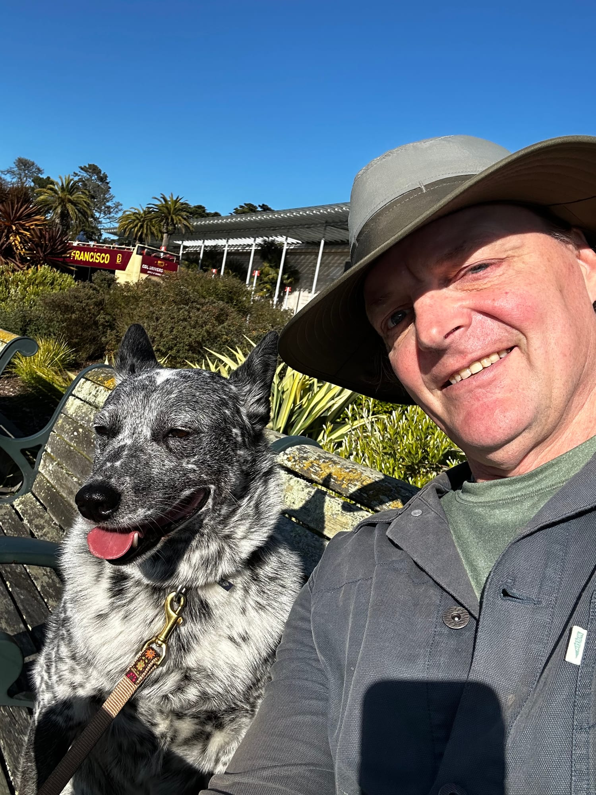

## My name is Jeffrey

I started BiomeMechanics to provide maintenance gardening services in the San Francisco Bay area. A constant student of horticulture, natural history, and the biodiversity of our Bay Area home, I specialize in building garden health from the soil, mycorrhizal and invertebrate communities upwards through pollinator communities and ultimately to our human physical and mental health.

Call [415-378-7755](tel:+14153787755) or email [info@biomemechanics.com](mailto:info@biomemechanics.com) to book an initial consultation.
