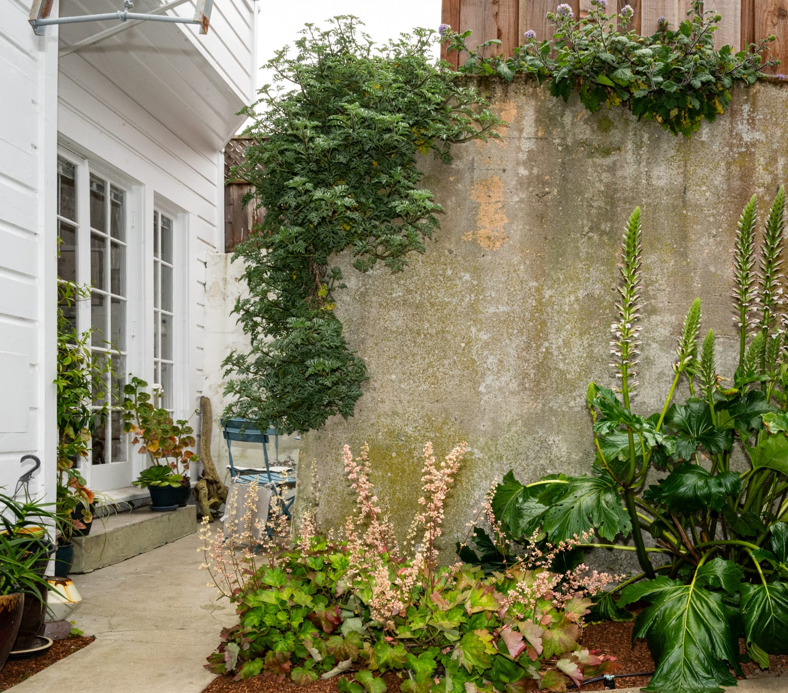

*Jeffrey · December 12, 2024 · 4 min read*

It can be difficult to know what you want to do with the design direction of your yard. This is particularly true when looking at either the blank slate of a new yard or the accumulated decisions others have made over time to the home into which you just moved. For some folks thinking about your own landscaping aesthetic is a new endeavor. Where does one even begin?

Do you want a refuge, a place to throw outdoor parties, a place for young kids to play, or an area for growing your own vegetables or cut flowers? Do you have dogs? Think about how long you are planning to stay in your space. Will your kids grow up there? Will you grow old there? Is this home associated with a temporary job assignment meaning you won't need to think about long term decisions? Planning a space that can adapt as your needs change can be a good strategy for many people, especially for those starting a new family. All of these considerations can affect your mental approach, and your budget choices as you consider your landscape choices.

Designs can range from formal gardens to cottage gardens, traditional Japanese gardens to modernist creations. They can include meadows, lawns, rock gardens, paths, decks, fences, raised beds, lighting, water features and entertainment areas, or nooks for quietly sitting and enjoying your morning tea or coffee and the sounds of the birds. Consider whether you need to design with specific accessibility considerations in mind. Do you want to provide a [habitat for insects, butterflies, and birds](https://bringingbackthenatives.net/douglas-tallamy-resources), or do you see kids and adults playing sports? Or will it be a backdrop viewed mostly from the house or deck? Do you need/want a low water garden, or can/will you commit to irrigation and meeting the needs of some plants that may be more thirsty than others.

It is now a more potent reality that we must [consider fire safety in our choices](https://www.sunset.com/home-garden/landscaping/firescaping-fire-defensive-tips) - keeping mulches and ladder fuels away from the immediate vicinity of structures - important in all areas along the built/wildlands interface.

Another consideration is how much time, effort, or money you will want to dedicate to maintaining your garden. Gardens are living things that evolve and grow over time. Maintenance can include mowing, weeding, pruning, watering, and addressing problems. Understand how much time you can dedicate to this. If you lack time but have the means, consider hiring a reputable gardener to help maintain the space.

Take a look at the climate of your yard, or more specifically, the microclimates of your yard - what spaces are present, do they face North, South, East or West. Do you live in an urban area, a forested area, areas of farmland and meadow. What is your latitude and what are your high and low temperatures? What is the natural plant community where you live?

So now that I have laid out a large, but by no means exhaustive, list of considerations, how do you start to narrow some of these decisions?

- Walk your neighborhood or look at what the folks who live near you have done.
- Look for local garden tours.
- Visit local public and municipal gardens.
- Contact your local university agricultural extension service. In California, the [UC Agriculture and Natural Resources county master gardeners](https://mg.ucanr.edu/volunteer/FindUs/) often hold public events and seminars.
- Contact your local water district - [some have extensive information on water-wise gardening/xeriscaping](https://www.ebmud.com/water/conservation-and-rebates/watersmart-gardener/plants-and-landscapes-summer-dry-climates).
- Consider looking up local groups specializing in Native Plants (ex. [California Native Plant Society county chapters](https://www.cnps.org/chapters/map)), [Rosarian societies](https://www.sfrosesociety.org/), [Dahlia societies](https://sfdahlias.org/), etc.

Make a note of how healthy plants look, what sun and wind exposure they have and how much shading they endure, what the soil and drainage considerations may be, how big they are now - then look for this same plant in other contexts and compare how they look. This will help you determine if your conditions will favor that plant or whether it stays as something you appreciate in contexts other than your own landscape.

All of the above resources have an advantage in that they aren't necessarily trying to sell you anything. The resources below may or may not be as perfectly unbiased, but still can be great sources of information and in the best circumstances extremely good resources.

- Visit your local nurseries/garden centers and note what plants they carry (this will typically vary by season). Avail yourself of the expertise of the employees on what grows well in your area, what conditions the plants appreciate, ask about their disease and pest resistance and whether they become [difficult to control](https://www.cal-ipc.org/) in the environment.
- Websites - such as the very excellent [Calscape website](https://www.calscape.org/) (California specific) can be great sources of design ideas, location specific plant ideas, and lists of professionals who can help you design, install and maintain your garden.

Do as much of this work as your time/effort budget allows even if you are planning on hiring a landscape architect or landscape designer as you will be able to give better direction in your conversations with these professionals and hopefully save yourself money and more quickly arrive at a design that will truly work with your life.

Good luck on your gardening adventure!
